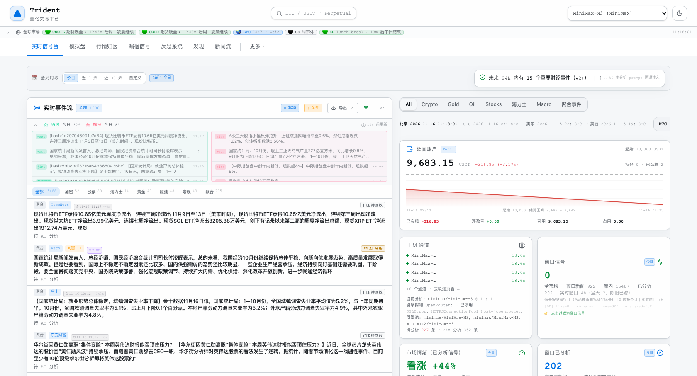

<div align="center">

# Cut the Trades You Shouldn't Take

### Raise your decision accuracy. Raise your odds.

[](#1-before-the-order-the-situation-not-a-call)
[](./LICENSE)
[](./backend/requirements.txt)
[](https://github.com/stardust888888/reflex-quant/actions)
[](#boundaries-up-front)

**English** | [中文](./README.md)

| Gate evaluations | Directional calls | Passed | Blocked |
| :---: | :---: | :---: | :---: |
| 735 | 156 | 20 | **136 · 87.2%** |

</div>

It speaks twice around every order.

**Before the order** — what the situation actually is, whether this order belongs, and why.
**After the order** — if it went wrong, where.
**Next order** — last order's lesson becomes this order's gate.

---

## 1. Before the order: the situation, not a call

Not a buy/sell signal. A picture you can read:

- **Market state** — how stale the quote is, how wide the volatility, whether this symbol is doing something abnormal today.
- **Account state** — does the ledger reconcile, is this a duplicate run, how much leverage is used, what the worst case is if this order fills.
- **Evidence** — how many hard facts support it, how many contradict it, how wide the disagreement is.

All three must pass before a signal is emitted. One missing → score cut. Two missing → no signal. **The ones it refuses to emit are its "don't take this trade."**

Real output looks like this:

> **BTC** — spot ETF net outflow USD 3.713 bn over 20 days (6th percentile), on-chain active addresses still expanding.
> Money leaving, usage growing, dispersion 0.64 → **no direction**. Suggestion: no add, wait for flows to turn.

---

## 2. After the order: where it went wrong

Every loss is filed under one of 33 error codes, each with an executable fix — not "bad psychology".

> **2026-11-19 · BTC long −2.1%**
> Cause: E002 stale quote — decided on the 18:40 print, filled after 19:26
> Missed: the 19:00 volume breakdown was not detected
> Next time: reject any order whose quote is older than 5 minutes

Winners are booked the same way — **what worked must be repeatable, what failed must be blocked.**

---

## 3. Next order: the lesson becomes a gate

Attribution is not an archive. The codes are tiered:

- `hard` (15) → enters the gate; the same setup is rejected next time;
- `soft` (8) → warning only;
- `research` (16) → needs statistical validation, not trusted on small samples.

Accuracy does not come from "I'll be careful next time". It comes from **last mistake being physically unable to pass this time.**

---

## 4. Why it actually raises accuracy

Accuracy = right trades ÷ all trades. The numerator needs skill; the denominator needs discipline. **It only moves the denominator — and the denominator never needs prediction.**

**Measured, not marketed**: in 735 gate evaluations on this machine, there were 156 directional attempts, 20 passed, **136 blocked (87.2%)**; the other 579 were HOLD (no direction). One query reproduces it:

```bash
sqlite3 backend/trident_event_bus.db \
  "SELECT COUNT(*) FROM gate_evaluations WHERE action IN ('BUY','SELL') AND passed=0;"
```

That is **not** "accuracy improved by 87%". It is "87% of attempts were not allowed." The difference between those two sentences is the whole project.

**1. It deletes orders that are certain to be wrong.** Stale quotes, an unreconciled ledger, duplicate runs, breached leverage — these are operational errors, not judgement calls. Anyone who blocks them avoids them 100%. A smaller denominator with the same numerator is a higher hit rate.

**2. No evidence, no signal.** If the supporting facts don't clear the bar, no order is emitted. **Flat is not a wrong trade** — it never enters the denominator.

**3. The same mistake cannot happen twice.** `hard` codes enter the gate; the place you got burned is physically closed next time. Repeated errors are the biggest leak in accuracy, and closing that leak needs no extra cleverness.

**4. It shuts up when disagreement is wide.** When longs and shorts are balanced (BTC dispersion 0.64), it refuses to pick a direction instead of forcing one. **False certainty is the second biggest source of wrong trades.**

**5. Every lesson becomes a rule.** Attribution must land in a parameter or a gate; if it cannot be written as a rule, it was not learned.

In one line: **it doesn't raise accuracy by making you guess better — it raises accuracy by making you guess less.**

---

## 5. Verify it yourself

```bash
cd backend && python3 scripts/iteration_check.py    # 40s, three lines
python3 scripts/offline_selftest.py                  # 30s, never touches the production DB
```



---

## Boundaries, up front

- **Paper + MockAdapter. No real money. It never places an order for you.**
- Win rate and edge are reported as `NULL` — below the sample threshold, no number is printed.
- **No return promises.** Only this: lose less of what you were going to lose anyway, and let probability do the rest.

---

## Quick start

```bash
cp backend/.env.example backend/.env      # your keys; every field may stay empty (degrades gracefully)
cd backend && pip install -r requirements.txt
python3 src_python/api_server.py          # :8000

cd frontend && npm install && npm run dev # :3000
```

Or `docker compose up`. Zero-cost deployment: [`DEPLOY.md`](./DEPLOY.md).

---

## Dig deeper

| Looking for | Where |
|---|---|
| Run it in 10 minutes | [`docs/QUICKSTART.md`](./docs/QUICKSTART.md) |
| Where the 422 endpoints live | [`docs/API-MAP.md`](./docs/API-MAP.md) |
| Which feed feeds which asset, and how often | [`docs/DATA-SOURCES.md`](./docs/DATA-SOURCES.md) |
| Why the entry file is hard to read | [`docs/REFACTOR-api_server.md`](./docs/REFACTOR-api_server.md) |
| How it works | [`docs/ARCHITECTURE.md`](./docs/ARCHITECTURE.md) |
| FAQ | [`docs/FAQ.md`](./docs/FAQ.md) |
| What is next | [`docs/ROADMAP.md`](./docs/ROADMAP.md) |
| Technical detail, measured tables, known gaps | [`docs/README-详细版.md`](./docs/README-详细版.md) |
| Changes | [`CHANGELOG.md`](./CHANGELOG.md) |
| Deploy / security / contributing | [`DEPLOY.md`](./DEPLOY.md) · [`SECURITY.md`](./SECURITY.md) · [`CONTRIBUTING.md`](./CONTRIBUTING.md) |
