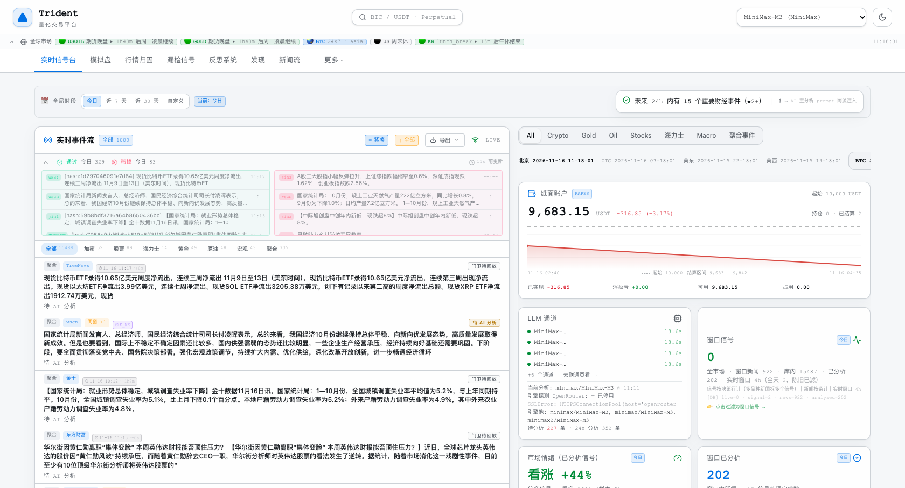

<div align="center">

# 剔掉不该做的单

### 提高你的决策正确率，提高你的赚钱几率

[](./LICENSE)
[](./backend/requirements.txt)
[](#边界写在前面)

**中文** | [English](./README.en.md)

</div>

它在你的每一单前后，各说一次话。

**下单前**：现在是什么情况、这单该不该下、为什么。
**下单后**：如果错了，错在哪。
**下一单**：上一单的教训，变成这一单的闸门。

---

## 一、下单前：告诉你现在是什么情况

不是给一个"买入/卖出"，是给一段能看懂的状况：

- **行情什么状态**：报价多旧、波动多大、这个品种今天有没有异常。
- **账户什么状态**：账对不对、有没有重复单、杠杆到哪、这单下下去最坏亏多少。
- **证据够不够**：支持它的有几条硬证据，反对它的有几条，两者分歧多大。

三条都过关才出信号；缺一条降分，缺两条不出信号——**不出的那些，就是"我不建议你下这单"**。

实测长这样：

> **BTC**｜ETF 20 日净赎回 37.13 亿美元（历史 6% 分位），链上活跃地址仍在扩张。
> 资金在撤、人在用，分歧 0.64 → **不给方向**。建议：不加仓，等资金流转正再说。

---

## 二、下单后：告诉你错在哪

每笔亏损归到 33 类错因里的一类，附一句能执行的改法，不是"心态不好"这种话。

> **2026-11-19 · BTC 多单 −2.1%**
> 错因：E002 数据过期——决策用 18:40 报价，执行在 19:26 之后
> 该动没动：19:00 放量下跌没被识别
> 下次：下单前查报价时间戳，超过 5 分钟直接拒单

赚的那笔也一样记账——**对的要能重复，错的要能拦住**。

---

## 三、下一单：把教训变成闸门

归因不是写完就存档。错误码按 `hard` / `soft` / `research` 分三层：

- `hard` 15 类：进闸门，同样情形下次直接拒单；
- `soft` 8 类：只提示，不拦；
- `research` 16 类：要统计验证，样本不够就不采信。

所以准确率不是靠"我下次注意"，是靠**上次的错，这次物理上过不去**。

---

## 四、为什么它真能提升

准确率 = 对的单 ÷ 所有单。分子靠本事，分母靠纪律。**它只动分母，而分母不需要预测能力。**

**实测，不是宣传**：本机 735 次闸门评估里，方向性决策 156 次，放行 20 次，**拦下 136 次（87.2%）**；其余 579 次本就是 HOLD（不给方向）。一条 SQL 可复现：

```bash
sqlite3 backend/trident_event_bus.db \
  "SELECT COUNT(*) FROM gate_evaluations WHERE action IN ('BUY','SELL') AND passed=0;"
```

这不是"准确率提升了 87%"，是"87% 的出手没被允许"。两句话的差别，就是这个项目的全部诚意。

**1. 删掉必然错的单。** 报价过期、账不平、重复下单、杠杆越界——这四类不是判断失误，是操作错误，只要有人拦，100% 能避免。分母少掉这些，准确率自然上移。

**2. 没证据就不出信号。** 支持的事实不够，就不下单。**空仓不是错单**——它不进分母，所以不拉低准确率。

**3. 同一个错不犯第二次。** `hard` 类错因进闸门，上次栽过的地方这次物理上过不去。重复犯错是准确率最大的漏斗，堵它不需要更聪明。

**4. 分歧大就闭嘴。** 多空打平（如 BTC 分歧 0.64）时不给方向，而不是硬凑一个。**假装确定，是错单的第二大来源。**

**5. 每条教训落成规则。** 归因必须落到参数或闸门；写不进规则的，就不算学会。

一句话：**它提升准确率的方式，不是让你猜得更准，是让你少猜几次。**

---

## 五、你能自己验

```bash
cd backend && python3 scripts/iteration_check.py    # 40 秒，三行结论
python3 scripts/offline_selftest.py                  # 30 秒，不碰生产库
```



---

## 边界（写在前面）

- **paper + MockAdapter，不接真钱，不替你下单。**
- 胜率、边际一律标 `NULL`——样本没到门槛，就不报数。
- **不承诺收益。** 只承诺把该输的少输一点，剩下的交给概率。

---

## 快速开始

```bash
cp backend/.env.example backend/.env      # 填你自己的 key（全部可留空，缺省降级）
cd backend && pip install -r requirements.txt
python3 src_python/api_server.py          # :8000

cd frontend && npm install && npm run dev # :3000
```

也可以 `docker compose up`。零成本部署见 [`DEPLOY.md`](./DEPLOY.md)。

---

## 想看更细

| 想了解 | 去哪 |
|---|---|
| 技术口径、实测表格、已知缺口 | [`docs/README-详细版.md`](./docs/README-详细版.md) |
| 版本变更 | [`CHANGELOG.md`](./CHANGELOG.md) |
| 部署 / 安全 / 参与 | [`DEPLOY.md`](./DEPLOY.md) · [`SECURITY.md`](./SECURITY.md) · [`CONTRIBUTING.md`](./CONTRIBUTING.md) |
