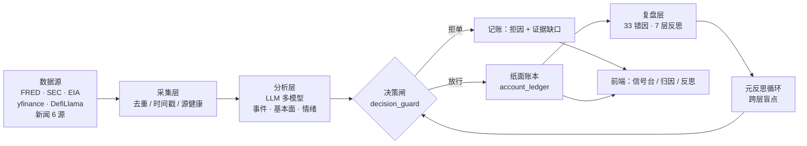

# 架构

一句话：**数据进来 → 出结论 → 过闸 → 记账 → 反过来审自己。**

## 四层，各管一件事

| 层 | 管什么 | 关键文件 |
|---|---|---|
| 采集 | 只收带时间戳与出处的事实，源坏了要报出来 | `src_python/feeds/` · `source_status` |
| 分析 | LLM 出结论，但结论必须挂硬证据 | `src_python/ai_worker.py` · `fundamental_factor.py` |
| 闸门 | 不该下的单直接拒，拒因记录可查 | `decision_guard.py` · `trade_preflight.py` |
| 复盘 | 每笔亏归一个错因，教训回灌成闸门规则 | `trade_reflections_v2` · `reflection_checkers.py` |

## 两条数据约定（整套系统靠它们自洽）

1. **每条结论必须能回到原始记录**：新闻 ID、报价时间戳、模型版本 hash。没有就标 `NULL`，不补 0。
2. **`NULL` ≠ `0`**：不知道就是不知道。胜率、边际、反思有效性在样本不足时一律 `NULL`。

## 想读代码从哪进

- 后端入口：`backend/src_python/api_server.py`（FastAPI，:8000）
- 桥接层：`backend/src_python/bridge_server.py`（:8100，独有路由）
- 决策闸：`backend/src_python/decision_guard.py`
- 账本：`backend/src_python/account_ledger.py` · `trade_preflight.py`
- 反思：`backend/src_python/reflection_checkers.py` · `blindspot_reflector.py`
- 功能目录（64 项）：`backend/src_python/trident2/catalog.py`
